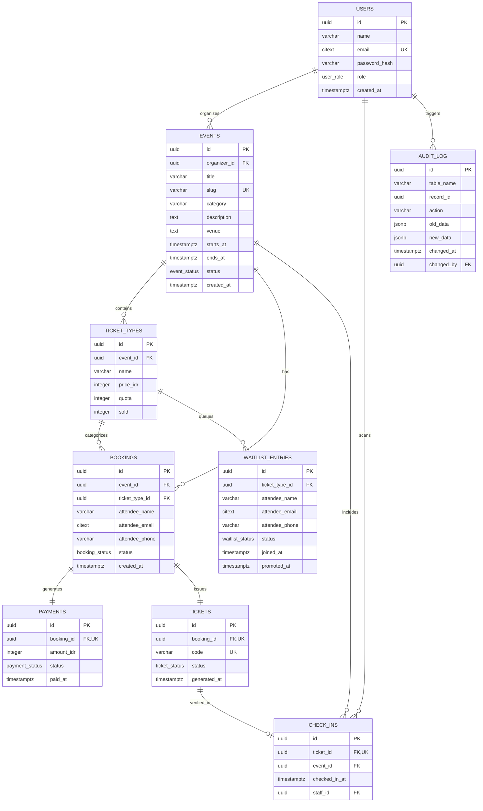

# EventLokal (EVENT 2 GO) 🎟️

Platform web modern untuk registrasi acara, penerbitan tiket digital dengan kode QR, dan manajemen antrean (*waitlist*) otomatis yang dirancang untuk panitia kampus serta komunitas lokal.

> **Tugas Akhir Semester**:  
> - **IK301 Sistem Basis Data Lanjut (Advanced Database Systems)**  
> - **IK102 Dasar Pengembangan Perangkat Lunak (Software Development Fundamentals)**

---

## 🚀 Fitur Utama

- 🎨 **Desain Modern & Responsif**: UI/UX bertema **EVENT 2 GO** (`#5953C7`) menggunakan Tailwind CSS, navigasi intuitif, dan animasi mikro yang halus.
- ⚡ **Transaksi Registrasi Atomik**: Mencegah *race condition* dan *overselling* kuota tiket dengan row-level locking (`SELECT ... FOR UPDATE`) pada level basis data.
- 📋 **Antrean Waitlist Otomatis (FIFO)**: Jika tiket habis, peserta dapat bergabung ke daftar tunggu. Saat ada pembatalan tiket (`cancel_booking`), sistem secara otomatis mempromosikan antrean terdepan.
- 📱 **QR Code Check-in & Scanner**: E-tiket digital dilengkapi kode QR unik anti duplikasi untuk verifikasi kehadiran cepat di pintu masuk acara.
- 📧 **Pengiriman E-Tiket Email Otomatis**: Integrasi pengiriman email konfirmasi dan lampiran PDF e-tiket via SMTP Mailpit.
- 📊 **Dashboard Manajemen Panitia**: Pantau metrik pendaftar, tingkat kehadiran real-time, grafik omzet, ekspor data peserta, dan wizard 3 langkah pembuatan event.

---

## 🛠️ Tech Stack & Arsitektur

| Komponen | Teknologi | Keterangan |
| :--- | :--- | :--- |
| **Frontend** | React 19, Vite, Tailwind CSS v4, Lucide React | Single Page Application (SPA) modern dan cepat |
| **Backend API** | FastAPI (Python 3.12), SQLAlchemy, Pydantic v2 | Arsitektur RESTful asynchronous dengan auto OpenAPI docs |
| **Database** | PostgreSQL 16 | UUIDv4, CITEXT, Stored Functions (PL/pgSQL), Triggers, Views, Partial Indexes |
| **E-Tiket & QR** | ReportLab, QRCodegen | Generator PDF tiket dan QR code resolusi tinggi |
| **Mail Server** | Mailpit | SMTP testing server & webmail inspector lokal |
| **Containerization** | Docker & Docker Compose v2 | Multi-stage build terisolasi siap produksi |
| **Docker Images** | Docker Hub | `radifmfz/eventlokal-frontend:latest`<br>`radifmfz/eventlokal-backend:latest` |

---

## 📦 Cara Menjalankan Aplikasi

### Prasyarat
- [Docker Desktop](https://www.docker.com/products/docker-desktop/) (Docker Compose v2)
- [Git](https://git-scm.com/)

### 1. Clone & Setup Environment
```bash
git clone <repo-url>
cd eventlokal
cp .env.example .env
```

### 2. Jalankan dengan Docker Compose

#### Opsi A: Build Lokal dari Source Code
```bash
docker compose up --build -d
```

#### Opsi B: Menggunakan Image dari Docker Hub (Tanpa Source Code Aplikasi)

Gunakan opsi ini jika Anda ingin langsung menjalankan aplikasi menggunakan image yang sudah di-push ke cloud tanpa perlu melakukan proses build ulang:
Cukup jalankan satu perintah ini di terminal
```bash
docker compose up -d
```

### 3. Akses Layanan

| Layanan | URL | Keterangan |
| :--- | :--- | :--- |
| **Web App (Frontend)** | [http://localhost:3000](http://localhost:3000) | Antarmuka pengguna EVENT 2 GO |
| **API Docs (Swagger UI)** | [http://localhost:8000/docs](http://localhost:8000/docs) | Dokumentasi interaktif REST API |
| **API Alternative (ReDoc)** | [http://localhost:8000/redoc](http://localhost:8000/redoc) | Dokumentasi API format spesifikasi |
| **Mailpit (Kotak Masuk Email)** | [http://localhost:8025](http://localhost:8025) | Kotak masuk lokal untuk cek e-tiket |
| **PostgreSQL Database** | `localhost:5433` (internal `5432`) | Koneksi database (User: `eventlokal`) |

---

## 👥 Akun Demo & Uji Coba

Data awal (*seed*) telah disediakan secara otomatis pada [db/init/04_seed.sql](db/init/04_seed.sql):

| Role | Email | Password | Hak Akses |
| :--- | :--- | :--- | :--- |
| **Penyelenggara (Organizer)** | `organizer@eventlokal.test` | `password123` | Kelola event, buat event baru, lihat laporan, atur waitlist & peserta |
| **Staf Lapangan (Scanner)** | `staff@eventlokal.test` | `password123` | Akses scanner QR dan verifikasi kehadiran peserta di pintu masuk |

> 💡 *Anda juga dapat mendaftarkan akun panitia baru secara instan melalui halaman `/daftar-panitia`.*

---

## 🗺️ Peta Rute Aplikasi (Sitemap)

### Rute Publik
- `/` — Landing page EVENT 2 GO, hero banner, sorotan event, dan layanan.
- `/events` — Katalog pencarian dan filter event publik.
- `/events/:slug` — Halaman detail event, jadwal, venue, dan pemilihan jenis tiket.
- `/events/:slug/checkout` & `/checkout` — Form checkout registrasi peserta dan konfirmasi pembayaran.
- `/events/:slug/waitlist` & `/waitlist` — Pendaftaran antrean daftar tunggu jika kuota tiket habis.
- `/tickets/sent` & `/ticket-sent` — Halaman sukses pendaftaran dengan instruksi e-tiket.
- `/template-email` — Pratinjau visual template email e-tiket.

### Rute Panitia & Staf
- `/login` — Halaman masuk akun panitia / staf.
- `/daftar-panitia` — Registrasi mandiri akun penyelenggara baru.
- `/dashboard` — Ringkasan metrik event aktif, event selesai, dan navigasi kelola.
- `/buat-event` — Wizard 3 langkah pembuatan event baru (Detail, Waktu/Venue, Kategori Tiket).
- `/manage-event/:id` — Pengelolaan detail event (Tab: Info Event, Peserta & Check-in, Scanner QR Kamera/Manual, Antrean Waitlist, dan Laporan Finansial).
- `/manage` — *Redirect otomatis* ke `/dashboard`.

---

## 🗄️ Entity Relationship Diagram (ERD)

Rancangan basis data relasional sistem terdiri dari 9 entitas utama yang saling terhubung dengan integritas referensial ketat:



> 📖 **Dokumentasi Lengkap Database**:  
> Lihat [db/erd/README.md](db/erd/README.md) untuk kamus data terperinci, aturan integritas referensial, dan daftar indeks.

---

## 🎯 Fitur Lanjutan Basis Data (IK301)

1. **Row-level Concurrency Lock (`FOR UPDATE`)**:
   Transaksi checkout dieksekusi di dalam stored function `checkout()`. Saat eksekusi, baris `ticket_types` dikunci secara eksklusif sehingga mencegah dua transaksi paralel menjual kuota tiket yang sama (anti over-selling).
2. **Promosi Antrean Otomatis (FIFO Queue)**:
   Stored procedure `cancel_booking()` mempromosikan peserta terdepan dari `waitlist_entries` secara otomatis berdasarkan waktu pendaftaran (`joined_at ASC`), sekaligus menerbitkan tiket baru.
3. **Partial Indexing Teroptimasi**:
   - `idx_unique_active_booking_per_event`: Menjamin keunikan email hanya untuk pemesanan yang aktif (`WHERE status IN ('pending', 'confirmed')`).
   - `idx_waitlist_queue`: Mengoptimasi pencarian antrean aktif (`WHERE status = 'waiting'`) dengan efisiensi $O(\log N)$.
4. **Audit Trail Otomatis (Triggers)**:
   Tabel `audit_log` menyimpan riwayat mutasi (`INSERT`, `UPDATE`, `DELETE`) secara transparan beserta data sebelum dan sesudah perubahan dalam format `JSONB`.
5. **Database Views**:
   - `v_public_events`: Menghitung batas harga termurah dan total sisa kuota untuk katalog publik.
   - `v_event_stats`: Agregasi statistik status acara (`upcoming`, `ongoing`, `finished`), jumlah pendaftar, dan tingkat kehadiran.
   - `v_ticket_type_revenue`: Rekapitulasi omzet per kategori tiket dan analisis kehadiran.

---

## 🧪 Menjalankan Pengujian (Automated Testing)

Seluruh pengujian fungsional backend mencakup pengujian kontrak rute, validasi skema Pydantic, keamanan token, pengiriman email, dan pembuatan QR code:

```bash
docker compose exec backend pytest
```

Output pengujian:
```text
tests/test_contract_routes.py ..                                         [ 11%]
tests/test_email_qr.py ....                                              [ 35%]
tests/test_health.py .                                                   [ 41%]
tests/test_routes.py ...                                                 [ 58%]
tests/test_schemas.py .....                                              [ 88%]
tests/test_security.py ..                                                [100%]
======================== 17 passed in 3.00s =========================
```

---

## 📂 Struktur Direktori Proyek

```text
EventLokal/
├── backend/
│   ├── app/
│   │   ├── core/           # Konfigurasi, keamanan JWT, dan template email
│   │   ├── db/             # Koneksi engine PostgreSQL (asyncpg / psycopg)
│   │   ├── repositories/   # Lapisan akses data (raw SQL & ORM)
│   │   ├── routers/        # Endpoint API FastAPI (auth, bookings, events, reports, checkins)
│   │   ├── schemas/        # Validasi Pydantic Request & Response
│   │   ├── services/       # Business logic, generator PDF e-tiket & email
│   │   └── main.py         # Entrypoint aplikasi FastAPI
│   ├── tests/              # Suite pengujian otomatis pytest (17 test cases)
│   └── Dockerfile          # Multi-stage image backend Python 3.12
├── frontend/
│   ├── src/
│   │   ├── api/            # API client Axios/Fetch terintegrasi
│   │   ├── components/     # Komponen UI (Modal Pembayaran, dsb)
│   │   ├── pages/          # Halaman aplikasi publik dan manajemen panitia
│   │   ├── utils/          # Helper pemformatan Rupiah dan tanggal
│   │   ├── App.jsx         # Konfigurasi rute dan navigasi React Router
│   │   └── index.css       # Tailwind CSS v4 styling
│   ├── nginx.conf          # Konfigurasi Nginx reverse proxy & SPA routing
│   └── Dockerfile          # Multi-stage build frontend (Vite build + Nginx Alpine)
├── db/
│   ├── erd/                # Dokumentasi ERD & Kamus Data
│   ├── init/               # Skrip inisialisasi basis data (schema, functions, views, seed)
│   └── perf/               # Pengujian performa kueri basis data (EXPLAIN ANALYZE)
├── docs/                   # Spesifikasi kontrak API dan dokumentasi akademik
├── docker-compose.yml      # Konfigurasi orkestrasi Docker Compose multi-kontainer
└── README.md               # Dokumentasi utama proyek
```

---

## 📄 Lisensi & Hak Cipta
Dibuat untuk keperluan akademik Tugas Akhir Kuliah Sistem Basis Data Lanjut (IK301) dan Dasar Pengembangan Perangkat Lunak (IK102).
Hak Cipta © 2024–2026 Tim Pengembang EventLokal (EVENT 2 GO).
