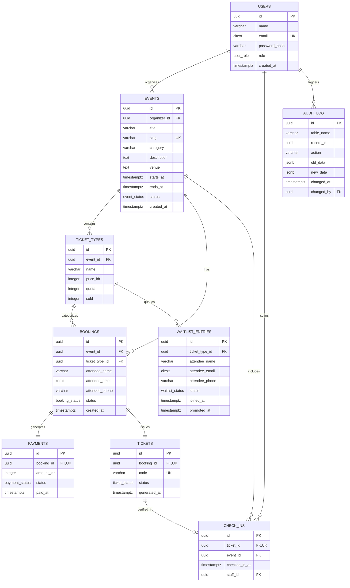

# EventLokal (EVENT 2 GO) 🎟️

A modern web platform for event registration, digital QR-code ticketing, and automatic waitlist management, designed for campus organizing committees and local communities.

> **Final Semester Project**:  
> - **IK301 Advanced Database Systems**  
> - **IK102 Software Development Fundamentals**

---

## 🚀 Key Features

- 🎨 **Modern & Responsive Design**: **EVENT 2 GO** themed UI/UX (`#5953C7`) built with Tailwind CSS, intuitive navigation, and smooth micro-animations.
- ⚡ **Atomic Registration Transactions**: Prevents race conditions and ticket quota overselling using row-level locking (`SELECT ... FOR UPDATE`) at the database level.
- 📋 **Automatic Waitlist (FIFO)**: When tickets sell out, attendees can join a waitlist. When a booking is cancelled (`cancel_booking`), the system automatically promotes the person at the front of the queue.
- 📱 **QR Code Check-in & Scanner**: Digital e-tickets carry a unique, duplicate-proof QR code for fast attendance verification at the event entrance.
- 📧 **Automatic E-Ticket Email Delivery**: Sends responsive HTML confirmation emails with embedded inline QR code e-ticket (CID image) via the Mailpit SMTP server.
- 📊 **Organizer Management Dashboard**: Track registrant metrics, real-time attendance rate, revenue charts, attendee data export, and a 3-step event creation wizard.

---

## 🌐 Live Production Deployment (Render Cloud)

Aplikasi **EVENT 2 GO** telah di-deploy dan aktif secara publik di cloud platform **Render** dengan arsitektur satu layanan terpadu (*unified service*):

| Layanan | Tautan Akses (Live URL) | Keterangan |
| :--- | :--- | :--- |
| **Web App (Produksi)** | [https://projecteventlokal.onrender.com/](https://projecteventlokal.onrender.com/) | Aplikasi live terpadu (Frontend React + Backend FastAPI) |
| **Cloud Database** | PostgreSQL Managed (Neon / Render) | Basis data relasional cloud terenkripsi SSL (`sslmode=require`) |

> 🔒 **Dukungan Kamera Scanner & HTTPS Penuh**:  
> Kebijakan keamanan browser modern (*WebRTC MediaDevices API*) mewajibkan konteks koneksi aman **HTTPS** (atau `localhost`) agar kamera perangkat dapat diakses. Melalui deployment di Render yang secara otomatis menyediakan enkripsi SSL/TLS resmi (`https://`), fitur **QR Code Scanner** panitia pada halaman `/manage-event/:id` dapat langsung memindai tiket peserta menggunakan kamera smartphone maupun laptop tanpa kendala pemblokiran izin kamera.

> ⚡ **Arsitektur Tunggal Terpadu (Zero CORS Issue)**:  
> Frontend React (Single Page Application) dibundel dan disajikan langsung oleh engine FastAPI backend melalui folder `./static`. Hal ini menyatukan frontend dan backend di bawah satu URL tunggal, mengeliminasi kompleksitas CORS (*Cross-Origin Resource Sharing*), serta mencegah error 404 saat me-refresh rute dinamis (seperti `/events/:slug` atau `/dashboard`).

---

## 🛠️ Tech Stack & Architecture

| Component | Technology | Notes |
| :--- | :--- | :--- |
| **Cloud Hosting** | Render (Web Service) | Unified single container deployment with automated HTTPS |
| **Frontend** | React 19, Vite, Tailwind CSS v4, Lucide React, html5-qrcode | Lightweight Single Page Application (SPA) with native Fetch API client |
| **Backend API** | FastAPI (Python 3.12), psycopg 3 (`psycopg[binary,pool]`), Pydantic v2 | High-performance RESTful API using raw SQL connection pooling (no ORM overhead) |
| **Database** | PostgreSQL 16/18 (Neon Cloud / Local) | ACID-compliant, UUIDv4, CITEXT, PL/pgSQL Stored Procedures, Triggers, Views, Partial Indexes |
| **E-Ticket & QR** | `qrcode[pil]`, Responsive HTML Email (CID inline) | Crisp PNG QR code generator embedded directly into responsive HTML e-ticket emails |
| **Mail Server** | Mailpit (SMTP & Web UI) | Local SMTP server (`localhost:1025`) and visual inbox inspector (`localhost:8025`) |
| **Containerization** | Docker & Docker Compose v2 | Multi-stage build (Node 20 + Python 3.12-slim) |
| **Docker Images** | Docker Hub | `radifmfz/eventlokal-frontend:latest`<br>`radifmfz/eventlokal-backend:latest` |

---

## 📦 How to Run the Application

### Pilihan 1: Akses Langsung di Cloud (Rekomendasi / Live Demo)
Anda tidak perlu menginstal dependensi apa pun di komputer lokal. Cukup buka tautan browser:
- 🌐 **Web App**: [https://projecteventlokal.onrender.com/](https://projecteventlokal.onrender.com/)

---

### Pilihan 2: Menjalankan Secara Lokal (Docker Compose)

Gunakan opsi ini untuk pengembangan lokal (*local development*) atau pengujian offline.

#### Prerequisites
- [Docker Desktop](https://www.docker.com/products/docker-desktop/) (Docker Compose v2)
- [Git](https://git-scm.com/)

#### 1. Clone the Repository & Set Up the Environment
```bash
git clone <repo-url>
cd eventlokal
cp .env.example .env
```

#### 2. Run with Docker Compose

##### Option A: Build Locally from Source Code
```bash
docker compose up --build -d
```

##### Option B: Use Images from Docker Hub (No Source Code Required)
```bash
docker compose up -d
```

#### 3. Access the Local Services

| Service | Local URL | Notes |
| :--- | :--- | :--- |
| **Web App (Frontend)** | [http://localhost:3000](http://localhost:3000) (atau `:8000`) | EVENT 2 GO user interface |
| **API Docs (Swagger UI)** | [http://localhost:8000/docs](http://localhost:8000/docs) | Interactive REST API documentation |
| **API Alternative (ReDoc)** | [http://localhost:8000/redoc](http://localhost:8000/redoc) | API documentation in specification format |
| **Mailpit (Email Inbox)** | [http://localhost:8025](http://localhost:8025) | Local inbox for checking e-tickets |
| **PostgreSQL Database** | `localhost:5433` (internal `5432`) | Database connection (User: `eventlokal`) |


---

## 👥 Demo Accounts & Testing

Seed data is provided automatically in [db/init/04_seed.sql](db/init/04_seed.sql):

| Role | Email | Password | Permissions |
| :--- | :--- | :--- | :--- |
| **Organizer** | `organizer@eventlokal.test` | `password123` | Manage events, create new events, view reports, manage waitlist & attendees |
| **Field Staff (Scanner)** | `staff@eventlokal.test` | `password123` | Access the QR scanner and verify attendee check-in at the entrance |

> 💡 *You can also register a new organizer account instantly via the `/daftar-panitia` page.*

---

## 🗺️ Application Route Map (Sitemap)

### Public Routes
- `/` — EVENT 2 GO landing page, hero banner, featured events, and services.
- `/events` — Public event catalog with search and filters.
- `/events/:slug` — Event detail page: schedule, venue, and ticket type selection.
- `/events/:slug/checkout` & `/checkout` — Attendee registration checkout form and payment confirmation.
- `/events/:slug/waitlist` & `/waitlist` — Waitlist registration when a ticket quota is sold out.
- `/tickets/sent` & `/ticket-sent` — Registration success page with e-ticket instructions.
- `/template-email` — Visual preview of the e-ticket email template.

### Organizer & Staff Routes
- `/login` — Organizer / staff sign-in page.
- `/daftar-panitia` — Self-registration for new organizer accounts.
- `/dashboard` — Summary of active events, finished events, and management navigation.
- `/buat-event` — 3-step event creation wizard (Details, Time/Venue, Ticket Categories).
- `/manage-event/:id` — Event management (Tabs: Event Info, Attendees & Check-in, QR Scanner via Camera/Manual, Waitlist Queue, and Financial Report).
- `/manage` — *Automatic redirect* to `/dashboard`.

---

## 🗄️ Entity Relationship Diagram (ERD)

The relational database design consists of 9 main entities connected with strict referential integrity:



> 📖 **Full Database Documentation**:  
> See [db/erd/README.md](db/erd/README.md) for the detailed data dictionary, referential integrity rules, and index list.  
> 📋 **User Requirements & Acceptance Criteria (IK102)**:  
> See [docs/user-stories.md](docs/user-stories.md) for 10 complete User Stories written in Given-When-Then format.

---

## 🏛️ Alasan Memilih PostgreSQL sebagai RDBMS Utama

Pemilihan **PostgreSQL 18** sebagai sistem basis data relasional untuk **EVENT 2 GO** didasarkan pada kebutuhan teknis dan integritas sistem tiket yang berkecepatan tinggi:

1. **Jaminan Transaksi ACID & Penanganan Konkurensi Kritis (*Ticket War*)**  
   Ketika kuota tiket menipis dan ratusan peserta checkout secara serentak, PostgreSQL menyediakan mekanisme penguncian baris pesimistik (*Pessimistic Row-Level Locking*) melalui `SELECT ... FOR UPDATE` di dalam stored function `checkout()`. Mekanisme ini hanya mengunci baris `ticket_types` yang sedang diproses tanpa memblokir pembacaan tabel lain, secara matematis menjamin **zero overselling** tanpa race condition.
2. **Dukungan Tipe Data Canggih & Ekstensi Native**  
   - **`citext` (Case-Insensitive Text)**: Memastikan email unik secara native tanpa perlu pemanggilan `LOWER(email)` yang dapat melumpuhkan indeks B-Tree.
   - **`UUIDv4` (`gen_random_uuid()`)**: Mencegah serangan enumerasi URL publik (misal `/manage-event/1`, `/manage-event/2`) secara kriptografis.
   - **`TIMESTAMPTZ`**: Menjamin keakuratan pencatatan waktu berbasis zona waktu (*Timezone Awareness*) untuk jadwal acara dan audit check-in.
   - **`JSONB`**: Menyimpan snapshot data sebelum (*old_data*) dan sesudah (*new_data*) perubahan di tabel `audit_log` secara efisien dan fleksibel.
   - **Tipe Data `ENUM` Domain**: Menegakkan validasi status (`event_status`, `booking_status`, `ticket_status`, `payment_status`, `waitlist_status`, `user_role`) langsung di level skema.
3. **Logika Bisnis Terpusat via Stored Functions / PL/pgSQL**  
   Fungsi transaksi krusial seperti `checkout()`, `cancel_booking()` (dengan promosi otomatis FIFO antrean waitlist), dan `join_waitlist()` dijalankan langsung di engine database. Ini memangkas latensi bolak-balik jaringan (*network round-trip latency*) dan menjamin konsistensi data dari klien mana pun.
4. **Partial Indexing (Indeks Bersyarat) yang Hemat Memori**  
   PostgreSQL mendukung pembuatan indeks unik bersyarat dengan klausa `WHERE`. Misalnya:
   - `idx_unique_active_booking_per_event`: Menjamin keunikan email hanya untuk pemesanan yang aktif (`WHERE status IN ('pending', 'confirmed')`), sehingga peserta yang pernah batal (`cancelled`) tetap bisa mendaftar ulang.
   - `idx_waitlist_queue`: Mengindeks antrean secara kronologis (`WHERE status = 'waiting'`) dengan kompleksitas pencarian $O(\log N)$ saat promosi FIFO.
5. **Kemampuan Analitik & Optimasi Kueri Unggul (IK301)**  
   Dukungan perintah `EXPLAIN (ANALYZE, BUFFERS)` untuk inspeksi rencana kueri mendalam, *buffer cache*, dan biaya eksekusi (*cost*) yang sangat esensial untuk pembuktian performa akademik.

---

## 🎯 Advanced Database Features (IK301)

1. **Row-level Concurrency Lock (`FOR UPDATE`)**:
   The checkout transaction runs inside the stored function `checkout()`. During execution, the `ticket_types` row is locked exclusively, so two parallel transactions cannot sell the same ticket quota (anti-overselling).
2. **Automatic Waitlist Promotion (FIFO Queue)**:
   The stored procedure `cancel_booking()` automatically promotes the first attendee in `waitlist_entries` based on registration time (`joined_at ASC`), and issues a new ticket at the same time.
3. **Optimized Partial Indexes**:
   - `idx_unique_active_booking_per_event`: Guarantees email uniqueness only for active bookings (`WHERE status IN ('pending', 'confirmed')`).
   - `idx_waitlist_queue`: Speeds up lookups of the active queue (`WHERE status = 'waiting'`) with $O(\log N)$ efficiency.
4. **Automatic Audit Trail (Triggers)**:
   The `audit_log` table transparently records the history of mutations (`INSERT`, `UPDATE`, `DELETE`) together with the data before and after each change in `JSONB` format.
5. **Database Views**:
   - `v_public_events`: Computes the lowest price and total remaining quota for the public catalog.
   - `v_event_stats`: Aggregates event phase statistics (`upcoming`, `ongoing`, `finished`), registrant counts, and attendance rate.
   - `v_ticket_type_revenue`: Summarizes revenue per ticket category and attendance analysis.

---

## 🧪 Running Automated Tests

The backend functional test suite covers route contract tests, Pydantic schema validation, token security, email sending, and QR code generation:

```bash
docker compose exec backend pytest
```

Test output:
```text
tests/test_contract_routes.py ..                                         [ 11%]
tests/test_email_qr.py ....                                              [ 35%]
tests/test_health.py .                                                   [ 41%]
tests/test_routes.py ...                                                 [ 58%]
tests/test_schemas.py .....                                              [ 88%]
tests/test_security.py ..                                                [100%]
======================== 17 passed in 3.00s =========================
```

---

## 📂 Project Directory Structure

```text
EventLokal/
├── backend/
│   ├── app/
│   │   ├── core/           # Configuration, JWT security, and email templates
│   │   ├── db/             # PostgreSQL connection pool using psycopg 3 (ConnectionPool)
│   │   ├── repositories/   # Data access layer (raw SQL repository pattern, no ORM)
│   │   ├── routers/        # FastAPI API endpoints (auth, bookings, events, reports, checkins)
│   │   ├── schemas/        # Pydantic request & response validation
│   │   ├── services/       # Business logic, QR code generator (qrcode[pil]) & HTML e-ticket email
│   │   └── main.py         # FastAPI application entrypoint
│   ├── tests/              # Automated pytest suite (17 test cases)
│   └── Dockerfile          # Multi-stage Python 3.12 backend image
├── frontend/
│   ├── src/
│   │   ├── api/            # Lightweight native Fetch API client wrapper with JWT bearer auth
│   │   ├── components/     # UI components (Payment Modal, etc.)
│   │   ├── pages/          # Public and organizer management pages
│   │   ├── utils/          # Rupiah and date formatting helpers
│   │   ├── App.jsx         # React Router routes and navigation configuration
│   │   └── index.css       # Tailwind CSS v4 styling
│   ├── nginx.conf          # Nginx reverse proxy & SPA routing configuration
│   └── Dockerfile          # Multi-stage frontend build (Vite build + Nginx Alpine)
├── db/
│   ├── erd/                # ERD documentation, data dictionary & PostgreSQL rationale
│   ├── init/               # Database initialization scripts (schema, functions, views, seed)
│   └── perf/               # Database query performance tests (EXPLAIN ANALYZE)
├── docs/                   # User stories (IK102), API contract, and backend module docs
├── docker-compose.yml      # Multi-container Docker Compose orchestration
└── README.md               # Main project documentation
```

---

## 🤖 AI Usage

## AI usage

We used AI tools during this project, as allowed by the exam brief.
Every AI-assisted output was reviewed, tested, and understood by the
member who owns that part.

### Tools used

| Tool | Version / model | Used by |
| --- | --- | --- |
| Claude | [model name] | [member names] |
| [e.g. GitHub Copilot] | [version] | [member names] |

### What we used AI for

| Area | How AI helped | Owner | What we changed or verified |
| --- | --- | --- | --- |
| Pitch deck | Drafted slide structure and wording | Kelompok 9 | Replaced placeholders with our interview data and checked all fee figures against official sites |
| Backend | [e.g. drafted endpoint boilerplate] | Nizar, Radif | [e.g. wrote and ran tests, fixed error mapping] |
| Frontend | [e.g. generated component skeletons from Figma] | Farel, Saiful | [e.g. connected to API, fixed layout bugs] |
| Database | [e.g. reviewed SQL, suggested index strategy] | Nizar, Radif | [e.g. ran EXPLAIN ANALYZE ourselves, kept screenshots] |

### What we did NOT use AI for

- Interviews and survey evidence

### Responsibility

Each member can explain the parts listed under their name. Code we could
not explain was rewritten or removed.

---

## 📄 License & Copyright
Made for the academic Final Project of Advanced Database Systems (IK301) and Software Development Fundamentals (IK102).
Copyright © 2024–2026 EventLokal (EVENT 2 GO) Development Team.