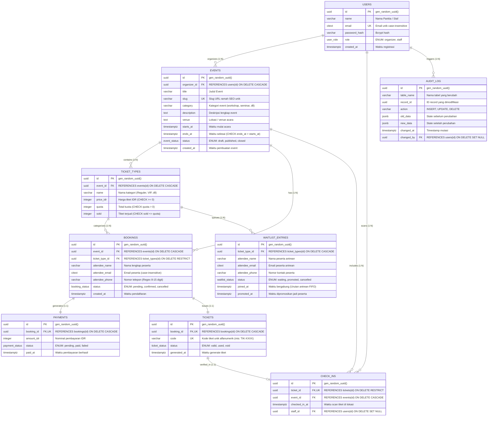

# Entity Relationship Diagram (ERD) - EventLokal (EVENT 2 GO)

Dokumentasi rancangan basis data relasional untuk sistem manajemen dan pendaftaran event kampus/komunitas **EventLokal**.  
Basis data diimplementasikan pada **PostgreSQL 16** dengan memanfaatkan fitur tingkat lanjut seperti UUID, `citext`, tipe ENUM, Partial Indexes, Row-level Locking (`FOR UPDATE`), Stored Procedures/Functions, Triggers, dan Views.

---

## 🏛️ Alasan Memilih PostgreSQL sebagai RDBMS Utama

Pemilihan **PostgreSQL 16** sebagai sistem manajemen basis data relasional (*Relational Database Management System*) untuk **EventLokal (EVENT 2 GO)** didasarkan pada kebutuhan teknis dan integritas bisnis sistem tiket:

1. **Jaminan Transaksi ACID & Penanganan Konkurensi Kritis (*Ticket War*)**
   - Sistem registrasi tiket rentan terhadap *race condition* ketika puluhan hingga ratusan peserta mencoba merebut kuota terakhir secara bersamaan.
   - PostgreSQL menyediakan mekanisme penguncian baris pesimistik (*Pessimistic Row-Level Locking*) melalui sintaks `SELECT ... FOR UPDATE`. Mekanisme ini mengunci secara eksklusif hanya baris `ticket_types` yang sedang diproses dalam fungsi `checkout()`, tanpa memblokir pembacaan baris tiket lain (*non-blocking reads*). Hal ini secara matematis mencegah terjadinya *overselling* (tiket terjual melebihi kuota).

2. **Dukungan Tipe Data Canggih & Ekstensi Native**
   - **`citext` (Case-Insensitive Text Extension)**: Menjamin keunikan alamat email peserta dan panitia secara native tanpa perlu memanggil fungsi manipulasi string `LOWER(email)` yang dapat melumpuhkan indeks B-Tree standar.
   - **`UUIDv4` (`gen_random_uuid()`)**: Menyediakan kunci primer acak berkekuatan kriptografis, mencegah kerentanan keamanan enumerasi data URL (misalnya menebak ID pemesanan `/manage-event/1`, `/manage-event/2`).
   - **`TIMESTAMPTZ`**: Menjamin keakuratan pencatatan waktu berbasis zona waktu (*Timezone Awareness*), krusial untuk jadwal mulai-selesai event dan audit check-in kehadiran di lapangan.
   - **`JSONB` (Binary JSON)**: Memungkinkan tabel `audit_log` menyimpan snapshot data lama (*old_data*) dan baru (*new_data*) secara terstruktur, efisien, dan dapat diindeks jika diperlukan audit mendalam.
   - **Tipe Data `ENUM` Domain**: Menegakkan validasi status (`event_status`, `booking_status`, `ticket_status`, `payment_status`, `waitlist_status`, `user_role`) langsung di level skema basis data sehingga data anomali tertolak sebelum masuk ke tabel.

3. **Logika Bisnis Terpusat via Stored Procedures / Functions (PL/pgSQL)**
   - Logika transaksi penting seperti `checkout()`, pembatalan tiket dengan promosi otomatis FIFO `cancel_booking()`, dan pendaftaran antrean `join_waitlist()` dikompilasi langsung di dalam engine database PostgreSQL.
   - Hal ini memangkas latensi bolak-balik jaringan (*network round-trip latency*) antara server aplikasi dan database, serta menjamin seluruh aturan integritas data terlindungi secara konsisten dari klien mana pun.

4. **Fitur Partial Indexing (Indeks Bersyarat) yang Hemat Memori**
   - Berbeda dengan DBMS tradisional lain, PostgreSQL mendukung pembuatan indeks parsial dengan klausa `WHERE`.
   - Contoh implementasi pada proyek ini:
     - `idx_unique_active_booking_per_event`: Menjamin email hanya boleh unik jika status pemesanannya masih aktif (`WHERE status IN ('pending', 'confirmed')`), sehingga peserta yang pernah membatalkan pesanan (`cancelled`) tetap diizinkan mendaftar kembali di kemudian hari.
     - `idx_waitlist_queue`: Membangun indeks B-Tree hanya untuk peserta yang berstatus antre (`WHERE status = 'waiting'`), mempercepat seleksi antrean pertama $O(\log N)$ saat promosi tiket terjadi.

5. **Query Optimizer & Performa Analitik Tingkat Lanjut (IK301)**
   - Fitur analisis kueri mendalam melalui perintah `EXPLAIN (ANALYZE, BUFFERS)` memungkinkan visualisasi *execution plan*, *index scan*, *buffer hit ratio*, dan biaya eksekusi (*cost*) kueri untuk pembuktian optimasi performa dalam kurikulum basis data lanjut.

---

## 1. Diagram ERD (Mermaid)

---

## 2. Kamus Data (Data Dictionary)

### 2.1. Tabel `users`
Menyimpan akun penyelenggara (organizer) dan staf lapangan (scanner).
- `id` (UUID, PK): Pengenal unik akun.
- `name` (VARCHAR(100)): Nama lengkap panitia atau staf.
- `email` (CITEXT, UK): Alamat email unik case-insensitive.
- `password_hash` (VARCHAR(255)): Hash password menggunakan algoritma Bcrypt (cost 10).
- `role` (user_role): Role akun (`organizer` atau `staff`).
- `created_at` (TIMESTAMPTZ): Waktu pembuatan akun.

### 2.2. Tabel `events`
Menyimpan master data event/acara.
- `id` (UUID, PK): Pengenal unik event.
- `organizer_id` (UUID, FK -> `users.id`): Penyelenggara pemilik event.
- `title` (VARCHAR(255)): Judul acara.
- `slug` (VARCHAR(255), UK): Slug unik untuk URL halaman publik.
- `category` (VARCHAR(100)): Kategori acara (mis: `workshop`, `seminar`, `konser`, `kompetisi`, `seni`).
- `description` (TEXT): Informasi deskripsi detail acara.
- `venue` (TEXT): Lokasi fisik atau link pertemuan daring.
- `starts_at` (TIMESTAMPTZ): Waktu mulai acara.
- `ends_at` (TIMESTAMPTZ): Waktu selesai acara (terdapat constraint `chk_event_time`: `ends_at > starts_at`).
- `status` (event_status): Status publikasi (`draft`, `published`, `closed`).
- `created_at` (TIMESTAMPTZ): Timestamp pembuatan record.

### 2.3. Tabel `ticket_types`
Menyimpan kategori tiket dan kuota pada setiap event.
- `id` (UUID, PK): Pengenal unik jenis tiket.
- `event_id` (UUID, FK -> `events.id`): Relasi ke event induk (Cascade delete).
- `name` (VARCHAR(100)): Nama kategori tiket (mis: Reguler, VIP, Mahasiswa).
- `price_idr` (INTEGER): Harga tiket dalam rupiah (`CHECK >= 0`).
- `quota` (INTEGER): Batas maksimum kapasitas tiket (`CHECK quota > 0`).
- `sold` (INTEGER): Jumlah tiket yang telah dikonfirmasi terpesan (`CHECK sold <= quota`).

### 2.4. Tabel `bookings`
Menyimpan transaksi registrasi/pemesanan tiket oleh peserta.
- `id` (UUID, PK): Pengenal transaksi booking.
- `event_id` (UUID, FK -> `events.id`): Event yang dipesan.
- `ticket_type_id` (UUID, FK -> `ticket_types.id`): Kategori tiket yang dipilih (Restrict delete).
- `attendee_name` (VARCHAR(100)): Nama lengkap pengunjung.
- `attendee_email` (CITEXT): Email pengunjung untuk pengiriman e-tiket.
- `attendee_phone` (VARCHAR(20)): Nomor telepon format baku 8–15 digit.
- `status` (booking_status): Status pemesanan (`pending`, `confirmed`, `cancelled`).
- `created_at` (TIMESTAMPTZ): Waktu registrasi.

### 2.5. Tabel `payments`
Menyimpan status dan informasi pembayaran untuk setiap booking.
- `id` (UUID, PK): Pengenal transaksi pembayaran.
- `booking_id` (UUID, FK -> `bookings.id`, UK): Relasi 1-ke-1 dengan pesanan.
- `amount_idr` (INTEGER): Total tagihan pembayaran.
- `status` (payment_status): Status pembayaran (`pending`, `paid`, `failed`).
- `paid_at` (TIMESTAMPTZ): Timestamp waktu pelunasan pembayaran.

### 2.6. Tabel `tickets`
Menyimpan e-tiket individual yang dilengkapi kode QR unik.
- `id` (UUID, PK): Pengenal unik tiket fisik/digital.
- `booking_id` (UUID, FK -> `bookings.id`, UK): Relasi 1-ke-1 dengan booking yang valid.
- `code` (VARCHAR(50), UK): Kode unik alfanumerik untuk barcode/QR scan di pintu masuk.
- `status` (ticket_status): Status keabsahan tiket (`valid`, `used`, `void`).
- `generated_at` (TIMESTAMPTZ): Timestamp penerbitan tiket.

### 2.7. Tabel `waitlist_entries`
Menyimpan antrean daftar tunggu ketika kuota kategori tiket sudah habis terisi.
- `id` (UUID, PK): Pengenal antrean waitlist.
- `ticket_type_id` (UUID, FK -> `ticket_types.id`): Kategori tiket yang diantrekan.
- `attendee_name` (VARCHAR(100)): Nama peminat antrean.
- `attendee_email` (CITEXT): Email peminat.
- `attendee_phone` (VARCHAR(20)): Nomor telepon peminat.
- `status` (waitlist_status): Status antrean (`waiting`, `promoted`, `cancelled`).
- `joined_at` (TIMESTAMPTZ): Waktu mendaftar antrean (Digunakan untuk pengurutan FIFO).
- `promoted_at` (TIMESTAMPTZ): Waktu peserta berhasil dipromosikan otomatis saat ada booking yang batal.

### 2.8. Tabel `check_ins`
Mencatat riwayat verifikasi kehadiran pengunjung di pintu masuk event.
- `id` (UUID, PK): Pengenal catatan check-in.
- `ticket_id` (UUID, FK -> `tickets.id`, UK): Tiket yang diverifikasi (Mencegah double check-in).
- `event_id` (UUID, FK -> `events.id`): Event tempat verifikasi dilakukan.
- `checked_in_at` (TIMESTAMPTZ): Waktu tepat peserta melakukan scan.
- `staff_id` (UUID, FK -> `users.id`): Petugas scanner yang memvalidasi tiket.

### 2.9. Tabel `audit_log`
Merekam jejak audit keamanan dan perubahan data sensitif secara otomatis via trigger.
- `id` (UUID, PK): Pengenal log audit.
- `table_name` (VARCHAR(100)): Nama tabel sumber perubahan.
- `record_id` (UUID): ID record yang mengalami perubahan.
- `action` (VARCHAR(50)): Jenis aksi (`INSERT`, `UPDATE`, `DELETE`).
- `old_data` (JSONB): Snapshot data sebelum mutasi.
- `new_data` (JSONB): Snapshot data sesudah mutasi.
- `changed_at` (TIMESTAMPTZ): Waktu mutasi terjadi.
- `changed_by` (UUID, FK -> `users.id`): User yang menginisiasi mutasi.

---

## 3. Strategi Indexing & Optimasi Kueri

| Nama Index | Tabel | Kolom | Tipe / Karakteristik | Tujuan Optimasi |
| :--- | :--- | :--- | :--- | :--- |
| `idx_events_organizer` | `events` | `organizer_id` | B-Tree | Mempercepat filter daftar event milik panitia pada dashboard. |
| `idx_events_status_starts` | `events` | `status, starts_at` | Composite B-Tree | Mempercepat kueri katalog event publik yang aktif dan urut tanggal. |
| `idx_ticket_types_event` | `ticket_types` | `event_id` | B-Tree | Akses instan daftar kategori tiket saat membuka halaman detail/checkout. |
| `idx_unique_active_booking_per_event` | `bookings` | `event_id, attendee_email` | **Partial Unique** (`WHERE status IN ('pending', 'confirmed')`) | Menjamin 1 peserta hanya bisa mendaftar 1 kali per event aktif tanpa menghalangi re-registrasi jika pernah batal (`cancelled`). |
| `idx_bookings_event_created` | `bookings` | `event_id, created_at DESC` | Composite B-Tree | Mempercepat pagination daftar peserta panitia secara kronologis terbaru. |
| `idx_unique_waitlist_per_ticket_type` | `waitlist_entries` | `ticket_type_id, attendee_email` | **Partial Unique** (`WHERE status = 'waiting'`) | Mencegah spam pendaftaran berulang pada antrean tiket yang sama. |
| `idx_waitlist_queue` | `waitlist_entries` | `ticket_type_id, joined_at` | **Partial Composite** (`WHERE status = 'waiting'`) | Menjamin eksekusi antrean **FIFO (First In First Out)** berkecepatan $O(\log N)$ saat promosi otomatis. |

---

## 4. Keunggulan & Fitur Basis Data Tingkat Lanjut (IK301)

1. **Concurrency Control & Row Locking (`FOR UPDATE`)**:
   Fungsi `checkout()` mengunci baris `ticket_types` secara atomik (`SELECT ... FOR UPDATE`) untuk mencegah *race condition* dan *overselling* saat ratusan peserta mendaftar tiket secara serentak.
2. **Promosi Antrean Waitlist Otomatis**:
   Fungsi `cancel_booking()` secara otomatis mencari peserta urutan pertama di `waitlist_entries` berdasarkan `joined_at ASC`, mengubah statusnya menjadi `promoted`, membuat booking baru, dan menerbitkan tiket secara otomatis tanpa intervensi manual panitia.
3. **Pencegahan Double Scan Tiket**:
   Constraint unik pada `check_ins.ticket_id` dan pembaruan atomik status tiket menjadi `used` mencegah tiket dipindai ulang lebih dari satu kali di pintu masuk.
4. **Database Views Teroptimasi**:
   - `v_public_events`: Menampilkan agregasi harga termurah (`min_price`) dan sisa kuota (`total_available_seats`).
   - `v_event_stats`: Mengagregasi status fase event (`upcoming`, `ongoing`, `finished`), total registrasi, dan kehadiran langsung.
   - `v_ticket_type_revenue`: Menghitung omset pendapatan per kategori dan tingkat kehadiran pengunjung.
